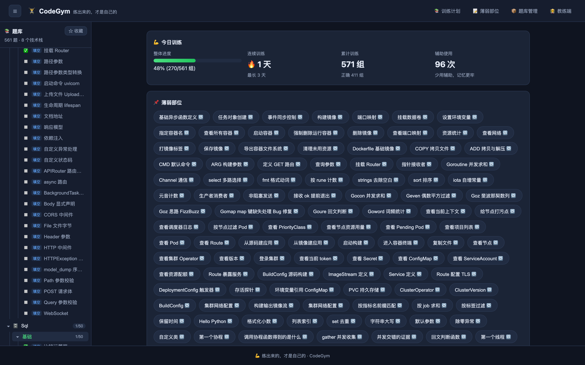
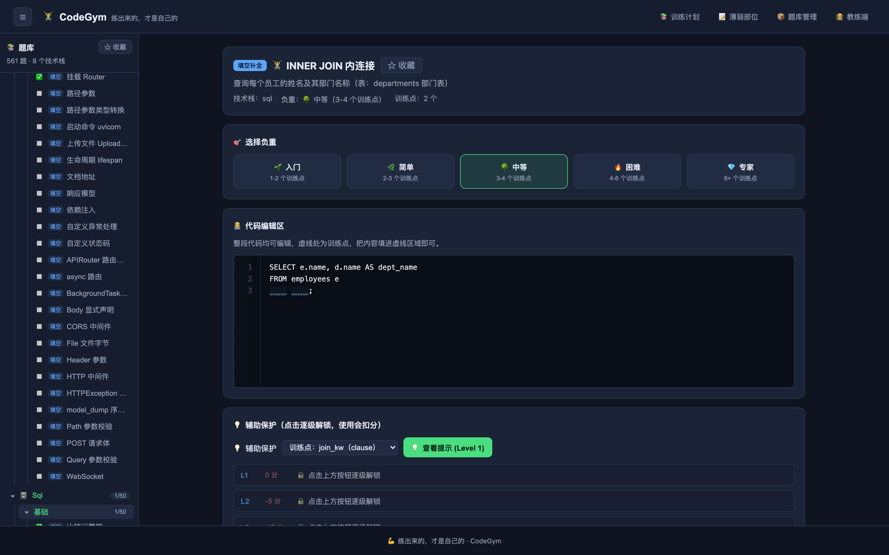
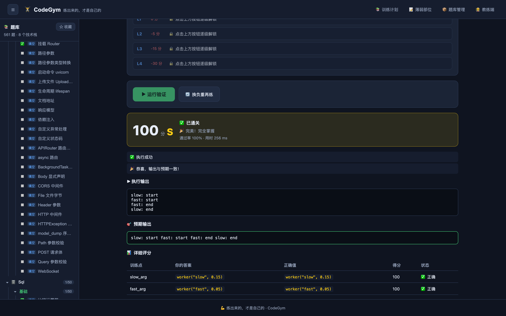

# CodeGym · 交互式代码训练平台

> 练出来的，才是自己的。


依据 `docs/design.md` 实现的 **Phase 1+2 可运行 MVP**：一个「填空-运行-验证」的代码训练闭环。
学员选择训练动作 → 选择负重级别 → 随机留空生成训练变体 → 填写训练点 → 运行验证 → 即时评分（S/A/B/C/D）→ 记录薄弱部位与成长进度。

## 界面预览

| 首页看板（含题库目录树） | 训练页（填空 + 负重 + 辅助提示） | 判题结果（真实执行 + 评分卡） |
|:---:|:---:|:---:|
|  |  |  |

## 功能总览

- 📚 **训练计划**：浏览 / 按技术栈筛选训练动作（Python / Go / JavaScript / Kubernetes / …）
- 👤 **用户体系**：注册 / 登录（PBKDF2 密码 + 会话 token），进度、收藏、薄弱点、连续打卡按用户独立保存；匿名访问回退到共享的 demo 用户
- 🧪 **我的题库**：每个用户可勾选要练的技术栈 / 子库（如只练 testing 的 pytest + selenium），保存后首页与侧边栏只展示所选范围，不勾选 = 全部题库
- 📥 **题库动态加载**：教练端上传题库 JSON 立即生效无需重启；把 JSON 放进 `data/bank` 目录也会被后端自动热扫描加载（`-bank-watch` 调整间隔）
- 🧑‍🏫 **用户管理（教练端）**：用户列表（作答 / 完成 / 连续天数）、创建账号、禁用 / 启用、重置密码、删除（连带清理其数据）
- 🐍 **Python 题库**：50 道基础题（语法/f-string/流程/列表推导/函数/递归/异常/类……），真实 `python3` 执行判题
- ⚡ **Python 协程题库**：20 道专项题（async/await/create_task/gather/超时与异常/异步迭代器/Queue/Semaphore……），真实 `asyncio` 执行判题
- 🧵 **Python 多线程题库**：20 道专项题（Thread/join/共享状态/Lock·RLock/Semaphore/Event/Barrier/threading.local/queue.Queue/Timer/线程池……），全部按确定性输出设计并真实执行判题
- 🧩 **Python 进阶题库**：90 道专项题，6 个子分类各 15 题、每题 6 个训练点（负重分级各档均有足够空位）——装饰器（wraps/带参/叠加/lru_cache/singledispatch/property）、迭代器与生成器（iter·next/yield/yield from/send/throw/close/islice）、描述符（__get__·__set__/__set_name__/数据与非数据优先级/classmethod 原理）、上下文管理器（__enter__·__exit__/contextmanager/suppress/ExitStack）、元类与类机制（type() 动态建类/__init_subclass__/MRO·super/__slots__/ABCMeta）、魔术方法（__repr__/__eq__·__hash__/__getitem__/__call__/__getattr__/运算符重载），真实执行判题
- 🤖 **Agentic AI 开发题库**：50 道 Python 题（消息与采样参数、工具 Schema 与注册分派、Agent 循环与 ReAct 轨迹、滑动窗口/摘要/向量检索/RAG、结构化输出校验、多智能体路由与 handoff、退避重试/成本核算/日志），真实执行判题
- 🐹 **Go 题库**：50 道基础题（语法/函数/切片/map/结构体/接口/并发/泛型……），真实 `go run` 执行判题
- 🔷 **Go 类型系统题库**：30 道专项题（零值与类型推断/iota/定义类型与别名/转换与 rune/类型断言与 type switch/结构体与方法集/嵌入与标签/接口隐式实现与 nil 陷阱/any/error/接口组合/泛型约束/指针语义），真实 `go run` 执行判题
- ⛓️ **Go 并发题库**：50 道专项题，3 个子分类——通信机制（goroutine/WaitGroup/channel/select/缓冲死锁，25 题）、同步与原子（Mutex·RWMutex/Once/atomic/Cond/Pool/数据竞争与并发 map 修复，13 题）、并发模式（生成器/Worker Pool/Fan-in·out/Pipeline/生产者消费者/context/Ticker/优雅关闭，12 题），真实 `go run` 执行判题
- 🧱 **数据结构系列题库**（60 题，Python 真实执行判题，6 个子分类各 10 题）：数组（双指针/二分/前缀和/差分/滑动窗口）、链表（反转/快慢指针/合并/环检测/两数相加）、栈与队列（括号匹配/逆波兰/最小栈/循环队列/单调栈与单调队列）、哈希表（手写哈希/两数之和/异位词分组/开放寻址/LRU）、树（遍历/BST/翻转/堆/Trie）、图（BFS/DFS/拓扑排序/并查集/岛屿数量/Dijkstra）
- ☸️ **Kubernetes 题库**：50 道基础题（kubectl 命令补全 + YAML 配置补全），支持别名答案（如 `-A` = `--all-namespaces`）
- 🎓 **CKA 认证题库**：150 道题，5 个子库各 30 题，按 CNCF CKA 考纲五大域组织——集群架构（kubeadm init/join/升级/etcd 快照备份恢复/证书续期/RBAC Role·Binding/kubeconfig 上下文）、工作负载（Deployment 滚动更新回滚扩缩/HPA/ConfigMap·Secret 注入与挂载/探针/资源限制/init·sidecar/DaemonSet/StatefulSet/Job·CronJob/亲和性污点容忍）、服务网络（Service 四类型/headless/ExternalName/手动 Endpoints/Ingress·TLS/CoreDNS/FQDN/NetworkPolicy 默认拒绝·namespaceSelector·egress/CNI·kube-proxy/节点宿主网络）、存储（PV hostPath·NFS·local/PVC 选择器绑定/StorageClass 动态供给·默认类·WaitForFirstConsumer/在线扩容/volumeMode Block/subPath/回收策略）、故障排查（NotReady 节点/kubelet journalctl/drain·uncordon/crictl/CrashLoopBackOff --previous/事件排序/镜像·探针·OOM·PVC·污点修复/控制平面静态 Pod/openssl 证书/DNS·连通性验证/can-i --list），命令与配置补全、答案匹配判题（支持 `-owide` 等别名）
- 🗄️ **SQL 题库**：50 道基础题（SELECT/WHERE 排序分页/聚合分组/多表 JOIN/子查询/DML/DDL 与约束……），围绕统一的示例库（员工/部门/商品/客户/订单）出题
- 📊 **BigQuery 题库**：61 道题，拆两个子库——「SQL 基础」（35 题：通用 SQL 语法）与「BigQuery 特有」（26 题：数组·STRUCT·UNNEST/JSON/窗口·QUALIFY/分区聚类/通配表/INFORMATION_SCHEMA/脚本变量/采样/时间旅行等 BQ 专属），围绕 sales 数据集出题
- 🚀 **DevOps 题库**：140 道题，拆四个子库——「terraform」（30）、「ansible」（30）、「docker」（50：命令 + Dockerfile/compose）与「prometheus」（30：promtool/HTTP API/PromQL/告警配置，答案匹配判题）
- ☁️ **AWS 题库**：180 道题，六个子库各 30 题——ec2（实例/镜像/EBS/安全组/弹性 IP）、iam（用户·组·角色/策略 JSON/信任与边界/临时凭证）、eks（集群/节点组/Fargate/OIDC·kubectl）、s3（桶/对象/存储级别/生命周期/加密/桶策略）、vpc（子网/路由/IGW·NAT/对等·端点/流日志）、rds（建库/快照恢复/只读副本/Multi-AZ/Aurora/参数组）
- 🌩️ **OpenStack 题库**：200 道题，10 个子库各 20 题——Nova（server/flavor/keypair/migrate/配额/nova.conf）、Neutron（network/subnet/router/安全组/Floating IP/ML2·OVS）、Cinder（volume/snapshot/backup/type/QoS/LVM·Ceph 后端）、Swift（对象上传下载/大对象/临时 URL/ring/中间件）、TripleO（undercloud/overcloud deploy/节点自省/roles_data/升级更新）、Keystone（token/项目·用户·角色/catalog/endpoint/fernet/policy）、Glance（镜像导入导出/共享/格式/多后端/缓存）、运维（服务巡检/日志/DB·MQ/高可用/疏散/备份）、升级（版本流/三阶段升级/DB 迁移/镜像 tag/回滚）、Ceph（集群状态/pool·RBD/CRUSH/认证/Cinder·Glance·Nova 对接），命令与配置补全、答案匹配判题
- 🧪 **测试框架题库**：180 道题，6 个子库各 30 题——pytest（断言·raises·approx/fixture/yield·scope·params/conftest/parametrize·indirect/tmp_path/monkeypatch/capsys/mock/skip·xfail/CLI·ini·pyproject 配置）、unittest（TestCase·断言族/setUp·tearDown/subTest/skip·expectedFailure/TestSuite·TestLoader·TextTestRunner/mock·patch·autospec/side_effect/assert_called_once_with/addCleanup/CLI）、selenium（Chrome 启动/By 定位/send_keys·click/text·get_attribute/Select/implicitly_wait/WebDriverWait·EC/ActionChains/iframe·窗口·alert/execute_script/headless/Remote Grid/Selenium Manager 与 Grid 命令）、playwright（TS：getByRole·TestId·Text/expect 断言族/route·fulfill·abort/storageState/beforeEach·test.step/soft 断言/request API/iframe/下载/playwright.config.ts/npx CLI）、cypress（JS：cy.visit·get·contains·within/type·click·check·select/should 断言族/intercept·as·wait/fixture·request·session/wrap·invoke·then/clock·tick/origin/Cypress.Commands.add/cypress.config.js/npx CLI）、locust（HttpUser·@task/wait_time·constant_pacing/on_start/client get·post/name·catch_response/events 监听/SequentialTaskSet·tag/FastHttpUser/LoadTestShape·tick/StopUser/headless·master·worker·csv·html CLI/locust.conf），代码填空 + 命令 + 配置补全、答案匹配判题
- ⭐ **收藏**：给需要加强的题目点 ★ 收藏，训练页与首页可随时取消，支持「只看收藏」筛选，有空多练练
- 🎯 **负重分级**：🌱入门 → 🌿简单 → 🌳中等 → 🔥困难 → 💎专家，随机留空数量随级别变化（设计 §5）
- 🧑‍💻 **四种题型**：填空补全、命令补全、配置补全、Bug 修复（设计 §4）
- 💡 **四级辅助保护**：轻提示 → 中提示 → 重提示 → 显答案，逐级扣分（设计 §6）
- ▶️ **运行验证**：Python / Go 训练点本地子进程执行（Go 通过临时 module `go run`），自动判题（设计 §7/§8）
- 📦 **题库导入 / 导出**：教练端一键导出整个题库为 JSON，可粘贴导入迁移/共享
- 📊 **训练成绩**：逐训练点评分、总分、评级、薄弱分析（设计 §7.5）
- 📝 **薄弱部位**：错题自动进错题本，支持一键重新加练
- 🔥 **成长追踪**：打卡连续天数、累计作答、完成进度（设计 §13）
- 🧑‍🏫 **教练端**：训练动作 JSON 创建 / 更新 / 删除，平台统计

## 技术栈

| 层 | 技术 |
|----|------|
| 后端 | Go 1.26 · net/http（标准库） |
| 数据库 | SQLite（modernc.org/sqlite，纯 Go） |
| 执行引擎 | 本地 Python 子进程（`PYTHON_BIN` 可配置，MVP 阶段） |
| 前端 | React 18 + TypeScript + Vite |
| 存储结构 | 与设计文档 §11 的 exercises / attempt_records / user_progress 表对应 |

> 设计文档推荐的 Docker/K8s 沙箱、PostgreSQL、Ollama 出题为后续 Phase，MVP 使用本地子进程与 SQLite 保证开箱即跑。

## 快速开始

### 方式一：Docker Compose（推荐）

```bash
docker compose up -d --build          # 前端 http://localhost:8088
# 生产环境务必设置教练端令牌：
CODEGYM_ADMIN_TOKEN=$(openssl rand -hex 16) docker compose up -d --build
```

### 方式二：本地开发

#### 1. 启动后端

```bash
cd backend
go run ./cmd/server -addr :8090        # 首次启动自动建库并 seed data/bank 下的全部内置题库（1616 题）
```

可选参数：`-db data/codegym.db` 指定数据库文件；`PYTHON_BIN` 指定 Python 解释器；
`-admin-token <token>`（或环境变量 `CODEGYM_ADMIN_TOKEN`）为教练端接口启用鉴权；
`-bank-watch 15s` 设置题库目录热扫描间隔（`0` 关闭，也可直接在教练端上传题库 JSON）。

#### 2. 启动前端

```bash
cd frontend
npm install
npm run dev                             # http://localhost:5190 （/api 已代理到 :8090）
```

打开 http://localhost:5190 即可开始训练。

## ⚠️ 安全提示

CodeGym 的定位是**个人/内网训练工具**，默认配置**未启用沙箱隔离，且未登录请求会落到共享的 demo 用户**：

- 学员账号（注册/登录）之间的进度/收藏/薄弱点互相隔离，但匿名访问仍可训练并写入 demo 用户；
- 教练端接口（创建/删除题目、用户管理、题库上传、导入导出、AI 出题）可被任意调用，除非启用令牌；
- 训练代码会在服务器本地以子进程真实执行（Python 直接运行、Go 经 `go run` 编译执行）。

**请勿将未加防护的实例暴露到公网。** 对外部署时：

1. 用 `-admin-token` / `CODEGYM_ADMIN_TOKEN` 启用教练端令牌（前端「教练端」页可保存令牌）；
2. 置于带认证的反向代理之后，限制来源 IP；
3. 如需强隔离，把后端放进容器并限制 CPU/内存/网络（K8s 沙箱在后续路线中）。


### 3. 运行测试

```bash
# 单元 + 集成测试（judge / variant / 全量 API 端到端，含 -race 竞态检测）
cd backend && go test ./... -race -count=1

# 前端类型检查、编辑区答案提取/渲染单测、生产构建
cd frontend && npm test && npm run build

# 实时端到端冒烟测试（需先启动后端 :8090 与前端 :5190）
python3 scripts/e2e_live.py
```

`backend/internal/api/e2e_test.go` 内置真实 SQLite + 真实 Python 子进程的完整接口测试
（列表/变体/执行/判题/进度/薄弱部位/教练 CRUD/导入/统计/超时/404）。
`frontend/src/components/CodeEditor.test.tsx` 覆盖 VSCode 风格编辑器的答案提取与渲染。
`scripts/e2e_live.py` 则通过前端代理对运行中的服务做全链路冒烟验证（65 项检查）。

## API 一览（设计 §12）

| 方法 | 路径 | 说明 |
|------|------|------|
| `GET` | `/api/v1/exercises` | 训练列表（`?tech_stack=` 筛选） |
| `GET` | `/api/v1/exercises/:id` | 训练动作详情（含答案字段，教练用） |
| `GET` | `/api/v1/exercises/:id/variant?level=easy` | 随机变体（训练点已留空，不含答案） |
| `POST` | `/api/v1/execute` | 提交答案 → 执行 → 判题 → 评分 |
| `GET` | `/api/v1/progress` | 学员成长进度 + 最近作答 |
| `GET` | `/api/v1/weak-points` | 薄弱部位列表 |
| `GET` | `/api/v1/environments` | 可用执行环境 |
| `POST` | `/api/v1/admin/exercises` | 创建训练动作（教练，需令牌） |
| `PUT` | `/api/v1/admin/exercises/:id` | 更新训练动作（教练，需令牌） |
| `DELETE` | `/api/v1/admin/exercises/:id` | 删除训练动作（教练，需令牌） |
| `GET` | `/api/v1/admin/export` | 导出整个题库（JSON，教练，需令牌） |
| `POST` | `/api/v1/admin/import` | 批量导入训练动作（教练，需令牌） |
| `GET` | `/api/v1/admin/stats` | 平台统计（教练，需令牌） |

> 教练端接口在启用 `-admin-token` 后需要携带 `X-Admin-Token: <token>` 或 `Authorization: Bearer <token>`；未启用时开放（仅限本地开发）。

## 目录结构

```
CodeGym/
├── docs/design.md              # 设计文档（需求来源）
├── backend/
│   ├── cmd/server/             # 入口
│   └── internal/
│       ├── model/              # 数据模型（设计 §11）
│       ├── store/              # SQLite 存储
│       ├── seed/               # 内置训练动作
│       ├── variant/            # 负重随机留空引擎（设计 §5）
│       ├── engine/             # 执行引擎（设计 §8）
│       ├── judge/              # 判题评分（设计 §7）
│       └── api/                # HTTP 接口（设计 §12）
└── frontend/
    └── src/
        ├── components/         # 代码编辑器 / 辅助面板 / 评分卡 / 负重选择
        └── pages/              # 看板 / 训练 / 薄弱部位 / 教练端
```

## 后续路线（对应设计 §16）

- Phase 3：Kubernetes / Docker 执行引擎、真实环境配置管理
- Phase 4：用户认证、权限、训练报告
- Phase 5：JSON/YAML 批量导入导出、AI 出题（Ollama）、数据仪表盘
- Phase 6：生产部署（Dockerfile、监控、安全加固）

## 贡献

欢迎提 Issue 与 PR！出题、修 Bug、加技术栈都可以，见 [CONTRIBUTING.md](CONTRIBUTING.md)。

## 许可证

- 代码：[MIT](LICENSE)
- 题库内容（`backend/data/bank/*.json`）：[CC BY-SA 4.0](LICENSE-DATA)
